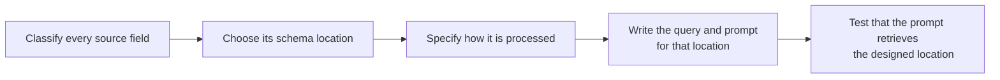
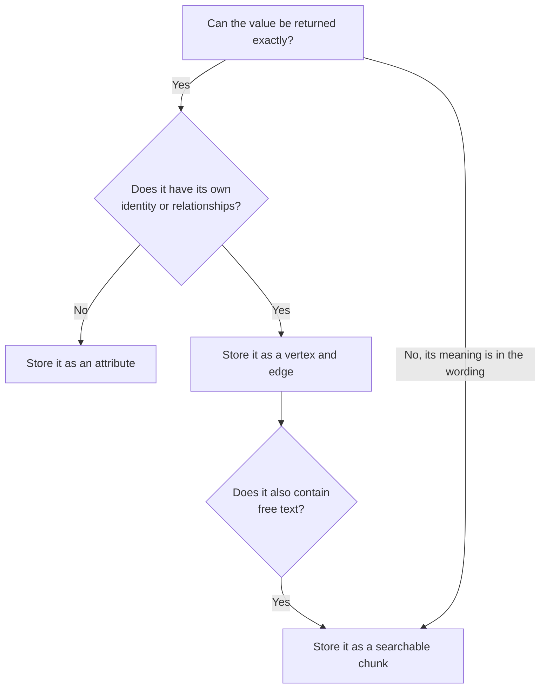
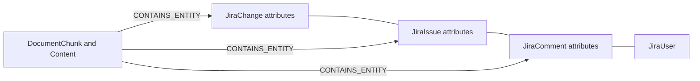
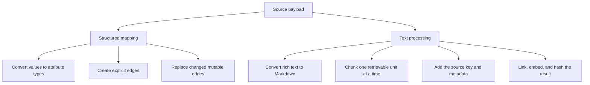
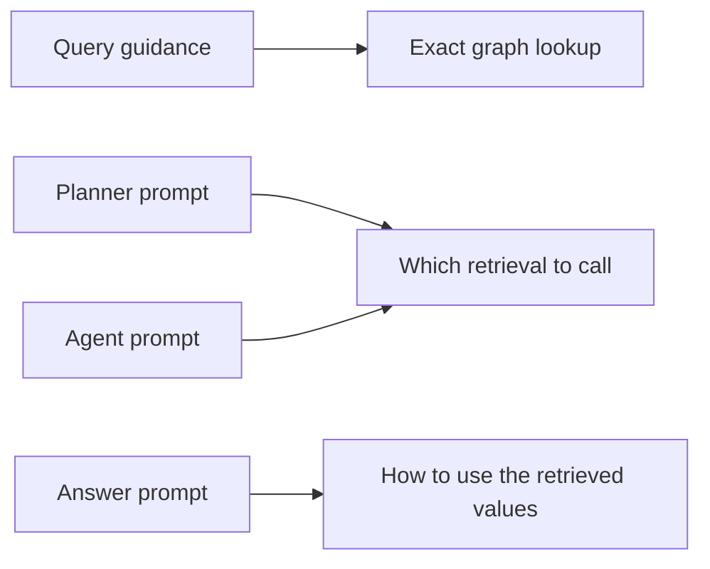

# Data ingestion guidelines and best practices : Data sources

## Purpose

This guide explains how to ingest a data source so its structured data and
unstructured data can be used together. It covers four design decisions:

1. How to design the schema.
2. Where each kind of data is stored.
3. How to process the data into that storage.
4. What query and prompt to design so the stored data can be fetched.

A data connector is the example. The Jira connector's schema, data, and
loading behavior show how to apply each decision. This guide does not explain
how to install or operate the connector.

The separate retrieval guide explains how an agent fetches the stored data
and combines it into an answer. This guide explains the ingestion design that
must be completed before that retrieval can work.

## Design flow



Do not start by copying an entire source record into one document. Decide the
retrieval job of each field, then design the schema and prompt for that job.

## 1. Design the schema

Use this decision for every field or child object:



### Jira design decisions

| Source data | Schema decision | Why |
| --- | --- | --- |
| Issue key, status, priority, due date | Attributes of `JiraIssue` | They are exact current values of the issue. |
| Assignee and reporter | `JiraUser` vertices plus edges | The same person can connect to many issues, comments, and changes. |
| Project | `JiraProject` vertex plus `JIRA_BELONGS_TO` | A project contains many issues and has its own name and URL. |
| Comment identity, author, and time | `JiraComment` vertex plus `JIRA_COMMENT_ON` and `JIRA_COMMENTED_BY` | A comment has its own ID, author, and lifecycle. |
| Comment wording | Searchable chunk linked to `JiraIssue` and `JiraComment` | The wording answers “why” questions that have no exact field. |
| Description | Searchable chunks linked only to `JiraIssue` | It belongs to the issue and has no separate source identity. |
| Status, assignee, priority, or resolution change | `JiraChange` vertex plus one searchable sentence | The old and new values must stay exact, while the sentence must remain searchable. |

The resulting storage contract is:



Apply these schema rules to any new source:

- Store a value as an attribute when it describes one vertex and does not need
  its own relationships.
- Create a vertex only when the object has a stable identity, its own
  lifecycle, or connections to other objects.
- Create an edge only for a relationship supplied by the source. Do not infer
  one from similar text.
- Store free text as `DocumentChunk` and `Content`. Connect each chunk to its
  owning domain vertices with `CONTAINS_ENTITY`.
- When one source object has both exact metadata and free text, store both.
  A Jira comment is the example: its author and timestamp are structured, and
  its body is also chunked.
- Build the vertex ID from the source identity so reprocessing updates the
  same vertex. A multi-source schema should include connector type, source,
  record type, and external ID. The current Jira IDs do not include a separate
  source identity, so a new design should not copy that limitation.

## 2. Design the processing



### Structured processing

Map exact fields directly into the attributes designed above. For Jira, status,
priority, due date, assignee, reporter, and project come from their source
fields. The processing must not derive an assignee by reading a comment.

Create a reply edge only when the source provides the parent comment ID. On a
later update, replace mutable edges such as the current assignee while keeping
the same issue vertex ID.

### Unstructured processing

Specify the text pipeline for each free-text field:

1. Convert the source format to clean text. Jira descriptions and comments use
   Atlassian Document Format, which is converted to Markdown.
2. Chunk by source object. Process the issue summary, description, each
   comment, and each supported change separately.
3. Put identifying context inside every chunk. A retrieved comment chunk must
   identify its issue, author, and time without requiring another lookup:

```text
Issue: GML-2186
Comment by Sam Lee at 2026-10-13 10:30:00:
The release is blocked until the identity team confirms the token timeout.
```

4. Use the graph chunk size and overlap. Preserve paragraphs, headings,
   tables, lists, and code. Split a long comment only when it exceeds that
   size.
5. Define any text that should be omitted. In Jira, a long log-dominated
   comment can have the log portion replaced with
   `[Log output omitted from search content.]`.
6. Link the chunk to the vertices designed for it, create its embedding, and
   save a content hash only after that succeeds.

The Jira processing uses one hash for the issue record, description, and
change sentences, and a separate hash for each comment. A changed comment
therefore refreshes only that comment's chunks. Do not combine all comments
and history into one document, because one edit would force all of that text
to be reprocessed.

## 3. Design the query and prompt

A schema is not retrievable until the prompts name its vertices, edges, and
chunk roles. Design four prompt sections for every source.



### Query guidance

This prompt instructs the graph-query generator. It must name the attributes
and edges that answer exact questions.

The Jira design says:

- Return scalar attributes, not a bare vertex. Return `display_name` for a
  user, `project_key`, `name`, and `url` for a project, and the requested
  named fields for an issue.
- For a broad issue lookup, make separate focused queries for the current
  issue, its comments, and its changes.
- Use `JIRA_COMMENT_ON` and `JIRA_COMMENTED_BY` for comments.
- Use `JIRA_HAS_CHANGE` and `JIRA_CHANGE_BY` for changes.
- Query `JIRA_HAS_PARENT` or `JIRA_LINKS_TO` only when the user asks about
  that relationship, and return the related issue key and `link_type`.

A new source needs the same kind of instruction: the vertex type, the exact
attribute names, and the edge used to reach each child object.

### Planner and agent prompts

These prompts tell the agent which designed storage location to query. They
must distinguish exact data from free text.

The Jira design says:

- Use structural retrieval for the current issue fields, assignee, reporter,
  project, comment metadata and body, and change values.
- Use hybrid search for the description and for supporting text. Include the
  exact issue key and requested subject in the search text.
- For one known issue that asks for both current state and explanation, call
  both retrievals.
- Do not use hybrid search as the only source of comment history or change
  history.
- When the user gives only a ticket number, return every matching issue key
  instead of choosing one.

For a new source, replace those Jira types and edges with the types designed
in section 1. The prompt must state which question shapes use attributes,
which use chunks, and which require both.

### Answer prompt

This prompt controls how the model reads the retrieved context. The Jira
design says:

- Treat structured rows and text passages as one issue.
- Prefer a structured value when the same field also appears in a passage.
- Use passages for the description and supporting explanation.
- Use `display_name`. Never present an internal vertex ID as a person's name.
- If neither result contains the requested fact, say it is not available.

A new answer prompt needs those precedence rules for its own fields. For
example, a ticket status must come from its structured attribute, while the
reason for a delay must come from the designed comment chunk.

## 4. Check the completed design

Review the design before implementation:

| Design item | Jira example | Required answer |
| --- | --- | --- |
| Exact field | Issue status | Which vertex and attribute store it? |
| Relationship | Assignee | Which two vertex types and which edge store it? |
| Mixed object | Comment | Which fields are attributes, and which text becomes chunks? |
| Chunk context | Comment body | Which issue key, author, and time are inside the chunk? |
| Update behavior | Edited comment | Which hash limits reprocessing to that comment? |
| Exact-query prompt | Comment author | Which edge and attribute does query guidance name? |
| Text-query prompt | Blocking reason | Which chunk role does the agent prompt select? |
| Answer precedence | Current priority | Which prompt says the structured value wins? |

The design is complete when every source field has a storage location, a
processing rule, and a prompt instruction that retrieves that location.
