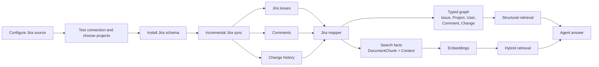
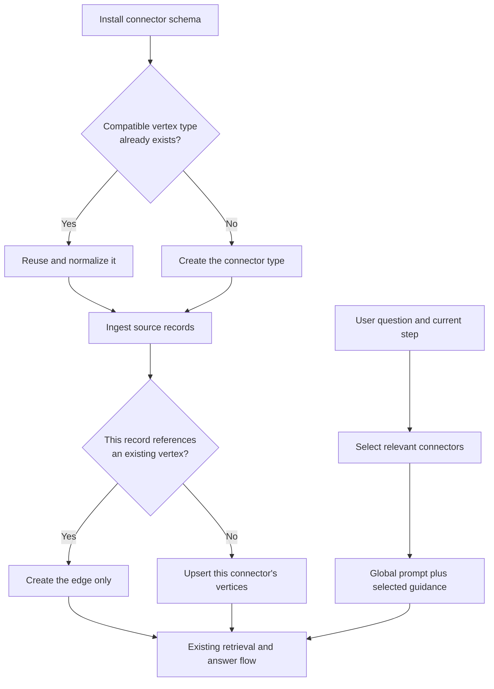
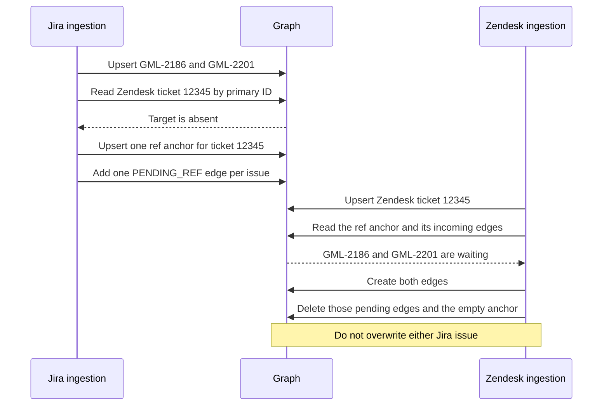
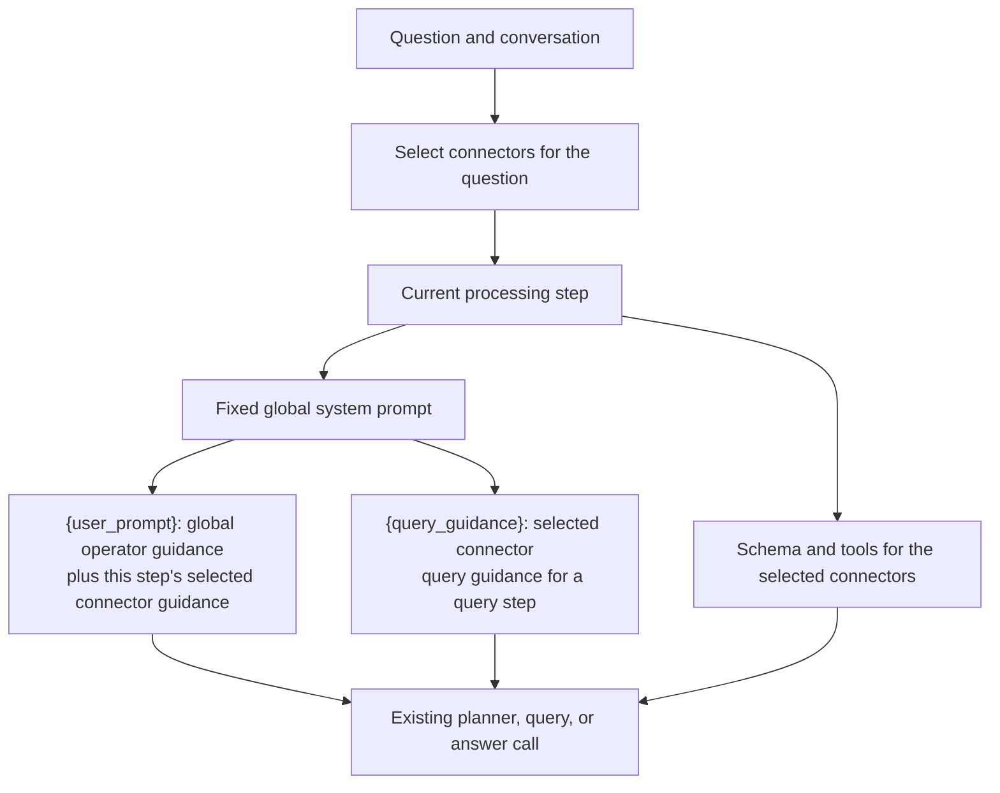
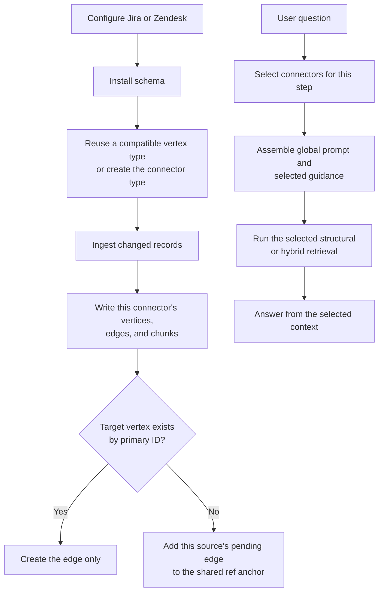

# Jira Connector and Multi-Source Design

Status: Proposed
Baseline: `GML-2211-feature-jira-source-connector` at `d4f8583`

## 1. Current design



The current connector:

- stores its graph-scoped configuration in
  `configs/graph_configs/<graph>/data_sources.json`;
- fetches issues, paginated comments, and selected Jira changes;
- writes typed Jira vertices and edges;
- creates searchable chunks for the current record, description, comments, and
  selected changes;
- performs incremental synchronization with checkpoint and hash-based recovery;
- uses structural retrieval for typed facts and hybrid retrieval for text.

The current prompt flow keeps one global system prompt for each processing
step. A graph can add operator guidance through the existing `{user_prompt}`
slot. Jira guidance is copied into that graph guidance today. Query guidance
is injected through `{query_guidance}` where that placeholder exists.

Main implementation:

- `graphrag/app/connectors/jira/client.py`
- `graphrag/app/connectors/jira/mapper.py`
- `graphrag/app/connectors/jira/schema.py`
- `graphrag/app/connectors/jira/sync.py`
- `graphrag/app/routers/data_sources.py`
- `graphrag-ui/src/pages/setup/DataSourcesConfig.tsx`

## 2. What does not scale

### Schema and cross-source links

Installing a second connector currently has no check for a compatible vertex
type that is already in the graph. Jira creates `JiraUser`, `JiraComment`, and
the other Jira types for itself. A Zendesk connector built the same way would
create a second person or comment type even when the existing type is
compatible.

A schema relationship and a data edge are different:

- The schema says which vertex types may be connected.
- A data edge connects two ingested records.

The current Jira sync can write Jira edges, but it does not create an edge to
an existing vertex from another connector when a Jira record references it.
It also has no rule that says an existing target vertex must be left unchanged
when the incoming record only needs an edge.

Comparing every Jira issue with every Zendesk ticket, or running a separate
job to discover relationships after both loads finish, is not the intended
flow.

### Prompts

Jira prompt text is copied into the graph prompt files, so it is sent with the
global guidance. Adding Zendesk by the same method would merge both
connectors into every planner, query, and answer call.

The default OpenCypher prompt still lacks `{query_guidance}`, so query
guidance is not injected into that template.

### Source identity

Current Jira IDs omit `source_id`:

```text
jira:<issue-key>:issue
jira:user:<account-id>
jira:comment:<comment-id>
```

A Jira issue key and a Zendesk ticket number are not the same identifier.
Matching numbers must not be treated as the same record.

## 3. Target design

The current configure, schema install, sync, retrieval, and answer flow stays
in place. Three parts of that flow change.



A connector installed alone still creates the entity types it needs. A
connector installed beside another one reuses a compatible shared type instead
of adding a duplicate.

## 4. Schema registration and ingestion-time edges

### Schema-level compatibility

This check is proposed. Schema installation today creates the Jira vertex
types without comparing them with another connector.

Before creating a vertex type, installation validates compatibility against
an existing type. Reuse is allowed only when all of the following are true:

- the types represent the same kind of entity, such as a person;
- their primary-key domains can be normalized without making two different
  entities produce the same key;
- required attributes already exist or can be added without changing the
  meaning of an existing attribute;
- an existing non-empty attribute owned by the other connector does not have
  to be replaced.

Normalization is limited to formatting that preserves identity. A URL can be
reduced to its configured source, record type, and external ID. Letter case
and leading or trailing spaces can be removed. Normalization must not remove
the connector or source portion, and it must not treat a Jira issue key as a
Zendesk ticket number because the two strings look similar.

`JiraIssue` and `ZendeskTicket` remain separate vertex types. Their identifiers
belong to different systems. Similar-looking values, including the same number
or the same display name, are identity collisions only if normalization would
assign them one primary key. In that case the types stay separate and no
shared vertex is created.

A person type may be shared when both connectors use one normalized account
identity and the same display-name attribute. If those keys differ, each
connector keeps its own person vertex. A connector installed on an empty graph
creates the types it needs. Removing one connector does not remove a shared
type that the other connector still uses, and it does not overwrite attributes
owned by the remaining connector.

### Data-level edges

During ingestion of one record, the connector creates a cross-source edge only
when that record supports it:

- the record contains a source reference, such as a canonical Zendesk or Jira
  URL or another qualified identifier; or
- the record uses a shared identity that already matches one compatible vertex,
  such as the same normalized person key.

The lookup is one primary-ID read for that target key. Ingestion already
addresses vertices by primary ID, and the current Jira sync already treats a
missing vertex ID as a normal result rather than a failed batch.
`getVerticesById` is not the lookup to use: the current sync avoids it because
that call errors when any requested ID is absent. The proposed read follows
the existing missing-ID handling for one key. It does not compare the ingested
record with every record from the other connector, and it does not add a
relationship-discovery service.

The reference is normalized to a canonical key such as
`zendesk:<configured-source>:ticket:12345`. A Jira issue key is never rewritten
into that form. If that target ID exists, ingestion creates the edge and stops.
If it does not, ingestion preserves one pending link per waiting source.

The pending target is an anchor vertex whose primary ID is `ref:` plus the
canonical key. The anchor contains no source-specific attribute, so creating it
again does not overwrite another issue. Each waiting source adds its own
`PENDING_REF` edge to that anchor. The edge identity is the source vertex, the
edge type, and the anchor, so `GML-2186` and `GML-2201` can both wait on ticket
`12345` without replacing each other.



When the target arrives, ingestion reads that one anchor and its incoming
pending edges. That read returns only the sources waiting for this target. It
creates each missing real edge, deletes only the pending edges it resolved, and
deletes the anchor only when no pending edges remain. Pending links for other
targets stay in place.

The same check runs inside Zendesk ingestion. When Zendesk is loaded first,
the ticket vertex exists, so Jira ingestion finds it by primary ID and creates
the edge immediately. No anchor is needed. Either ingestion order creates the
edges once both endpoints exist.

A retry upserts the same anchor and the same pending edge. It does not create
a second logical cross-source edge because the real edge also has one identity:
the source vertex, the target vertex, and the edge type. If the real edge
already exists, ingestion leaves it in place and removes any leftover pending
edge for that same source and target.

Concurrent ingestion can let the target appear after the missing-ID read but
before the pending edge is saved. The connector that writes the pending edge
therefore reads the target ID once more after saving it. If the target exists,
it creates the real edge and removes that source's pending edge immediately.
The connector that writes the target performs the anchor read after its own
upsert. Whichever write finishes last resolves the same edge idempotently, so
the reference is not left pending and the two writes do not create duplicate
edges.

When the incoming record only references an existing vertex, ingestion writes
the edge and does not upsert or overwrite that vertex. The connector that owns
the vertex remains responsible for its attributes.

Do not create the edge from similar text, the same customer name, or a bare
number that could belong to more than one source.

## 5. Connector configuration

Each connector keeps its own configuration, separate from the global prompt:

| Configuration | Jira example | Zendesk example |
| --- | --- | --- |
| Schema | Vertex and edge types it creates or reuses | Its own ticket schema, reusing a compatible shared type when present |
| Prompt guidance | Planner, query, and answer guidance for Jira types | The same three sections for Zendesk types |
| Metadata | Source ID, site, project scope, and enabled state | Source ID, subdomain, and enabled state |
| Global integration | Contributes its schema to the graph schema and its guidance to the existing prompt slots | Same integration points |

Connector guidance remains editable with that connector. It is not copied into
the global instructions. The global prompt remains the instruction used for
every applicable model call.

## 6. Selective prompt flow

The existing prompt path stays in place. Each fixed system prompt already
keeps its global rules. `_compose_prompt` fills `{user_prompt}` from the graph
prompt file, and the query tools fill `{query_guidance}` from
`query_guidance.txt`. Today those files contain the copied Jira guidance, so
every planner, query, and answer call receives it. Selective loading is
proposed; it is not implemented.



Question-level selection happens once from the question and conversation:

- a Jira key, Jira URL, or explicit Jira reference selects Jira;
- a Zendesk URL, qualified Zendesk identifier, or explicit Zendesk reference
  selects Zendesk;
- both select both connectors;
- a request for a relationship or evidence across the two selects cross-source
  guidance in addition to both connector sections.

Step-level selection then uses that set, but supplies only the portion the
current call already accepts:

| Existing call | Slot populated | Schema and tools supplied |
| --- | --- | --- |
| Planner, through `agentic_planner_prompt` | `{user_prompt}` receives the global operator guidance plus the selected connector's planner guidance | The existing tool catalog and schema summary are limited to the selected connectors |
| Structural query, through `map_question_schema_prompt`, `generate_function_prompt`, and `generate_gsql_prompt` | `{query_guidance}` receives only the selected connector's query guidance | The existing `{vertices}`, `{edges}`, and vertex-type inputs are limited to the selected types |
| OpenCypher generation | The default template does not contain `{query_guidance}` today. The proposed change adds that existing placeholder so this call receives the same selected query guidance | The existing `{schema}` input is limited to the selected types |
| Answer generation, through `chatbot_response` | `{user_prompt}` receives the global answer guidance plus the selected connector's answer guidance | No additional connector tool list is added |

The fixed system instructions remain in the template around those slots, so
global rules are present on every applicable call. Connector text does not
replace them. A query step does not receive planner or answer guidance, and a
Jira structural query does not receive Zendesk field instructions.

If the question gives no connector reference and no qualified identifier,
selection is ambiguous. The call keeps the global system prompt and global
operator guidance. It does not load every connector prompt to resolve the
ambiguity. When the source must be known to answer correctly, the existing
answer step asks which system the user means instead of choosing one and
answering. A bare number that exists in both Jira and Zendesk is this case:
the answer asks whether the user means the Jira issue or the Zendesk ticket.

## 7. End-to-end flow



## 8. Implementation plan

### Phase 1: schema reuse

- During schema installation, validate semantic type, primary-key domain, and
  required attributes before reusing a vertex type.
- Normalize formatting only. Do not collapse a Jira issue key and a Zendesk
  ticket number into one key.
- Keep `JiraIssue` and `ZendeskTicket` separate, and let either connector
  create its own types when installed alone.
- Do not replace attributes owned by the other connector.

### Phase 2: ingestion-time edges

- While ingesting one record, normalize an explicit reference or shared
  identity and read that one primary ID.
- Create the edge when the target exists, without upserting the target.
- When the target is absent, upsert one `ref:<canonical-key>` anchor and add
  a separate `PENDING_REF` edge for each waiting source.
- When the target arrives, resolve every pending edge on that anchor, delete
  only those edges, and delete the anchor only when none remain.
- After writing a pending edge, read the target again so a target created
  during the gap is linked immediately and the pending edge is not left behind.
- Repeat the same source-target edge on retry instead of creating a duplicate.

### Phase 3: selective prompts

- Keep each connector's planner, query, and answer guidance in its own
  configuration.
- Select the connector set from the question and conversation, then populate
  only the existing slot used by the current step.
- Fill `{user_prompt}` with global operator guidance plus the selected planner
  or answer guidance. Fill `{query_guidance}` with the selected query guidance.
- Limit the schema and tool inputs of the existing call to the selected
  connectors.
- Add the existing `{query_guidance}` placeholder to the default OpenCypher
  template. Leave global system instructions in place.
- For an ambiguous question, keep global guidance, do not load every connector
  prompt, and ask the user which source is meant when that choice changes the
  answer.

### Phase 4: Zendesk connector for testing

Jira alone cannot test this design. Zendesk must be created as a second data
source using the same connector flow: its own configuration, schema
installation, ingestion, structured records, searchable chunks, and prompt
guidance.

Testing requires both connectors on one graph:

- Install Zendesk on a graph that already has Jira and confirm a compatible
  person type is reused.
- Install each connector on an empty graph and confirm it creates the types it
  needs.
- Ingest a Jira issue that cites an existing Zendesk ticket and confirm only
  the edge is added.
- Ingest two Jira issues that cite the same missing Zendesk ticket and confirm
  that both pending edges remain. When the ticket arrives, confirm both edges
  are created and only that ticket's pending links are removed.
- Retry the same ingestion and create the target during the missing-ID gap.
  Confirm one logical edge remains and no pending link is left behind.
- Ask a Jira-only, Zendesk-only, cross-source, and ambiguous question. Confirm
  that only the relevant guidance is loaded and that an ambiguous question
  asks which source the user means.

## 9. Acceptance criteria

- Schema installation reuses a vertex type only after semantic type, primary-key
  domain, and required attributes pass validation.
- A connector installed alone can still create its own entity types.
- Normalization does not merge `JiraIssue` and `ZendeskTicket` when their
  identifiers look similar, and it does not overwrite attributes owned by the
  other connector.
- Several sources can wait on one missing target. Each has its own pending
  edge, and those edges do not overwrite one another.
- When the target arrives, every pending edge on its anchor is resolved.
  Unrelated pending links remain, and the anchor is removed only when it has
  no pending edges left.
- A retry or a concurrent write produces one logical edge and does not leave
  a resolved reference pending.
- Either ingestion order creates the edges once both endpoints exist.
- Ingestion does not compare every Jira record with every Zendesk record and
  does not run a separate relationship-discovery service.
- Referencing an existing vertex creates an edge without overwriting that
  vertex.
- `{user_prompt}` and `{query_guidance}` receive global guidance plus only the
  selected connector guidance for the current planner, query, or answer call.
- An ambiguous question keeps the global prompt, does not load every connector
  prompt, and asks the user which source is meant when that choice is required.
- Existing Jira ingestion and the current planner, retrieval, and answer flow
  remain compatible.

## 10. Recommendation

Modify schema installation, record ingestion, and prompt assembly. Do not add
a separate linking service or load every connector prompt on every step.

Do not:

- treat a Jira issue key and a Zendesk ticket number as the same identifier;
- compare all records from one connector with all records from another;
- overwrite an existing vertex when the record only needs an edge to it;
- copy every connector's guidance into the global prompt.
