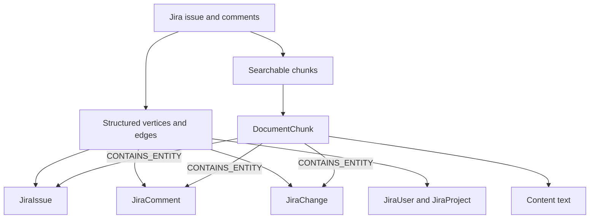
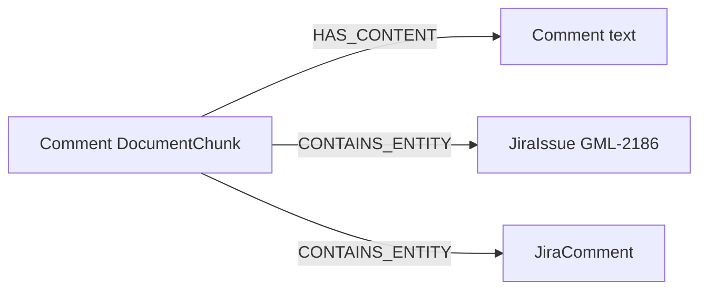
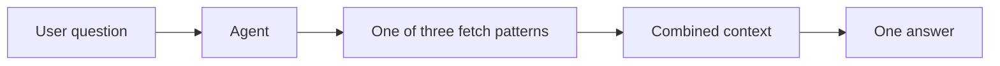
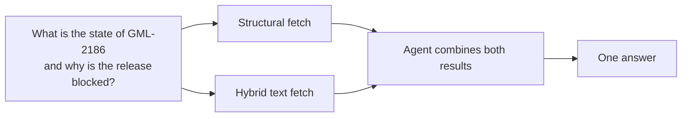
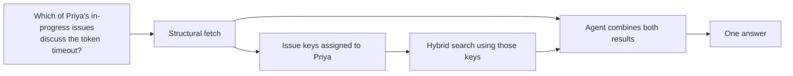
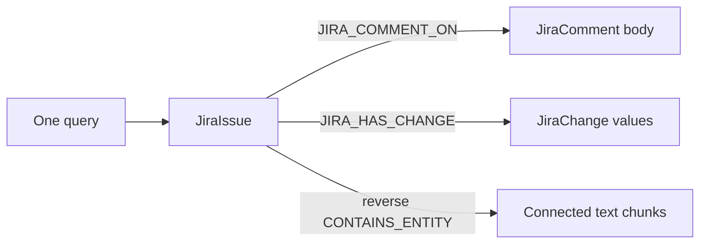

# How Structured and Unstructured Connector Data Are Stored and Used

## Purpose

This guide explains how connector data is stored in the graph and how GraphRAG
fetches it to answer a question. It uses the current Jira connector, especially
Jira comments, as the concrete example.

A connector stores the same source record in two connected forms:

- **Structured data** stores exact fields and relationships.
- **Unstructured data** stores searchable text for descriptions, comments, and
  change summaries.

The agent can use both forms in one user question. There are three ways the
two forms are fetched and then integrated.

## How the data is stored



### Structured storage

The Jira connector creates a vertex for each object that has its own identity.

| Source information | Vertex | Examples of stored fields |
| --- | --- | --- |
| Issue | `JiraIssue` | Issue key, summary, status, priority, due date, URL |
| Project | `JiraProject` | Project key, name, URL |
| Person | `JiraUser` | Account ID, display name |
| Comment | `JiraComment` | Comment ID, body, created time, updated time, visibility |
| Supported change | `JiraChange` | Field, previous value, new value, time |

Relationships are stored as edges:

- `JIRA_BELONGS_TO` connects an issue to its project.
- `JIRA_ASSIGNED_TO` and `JIRA_REPORTED_BY` connect an issue to users.
- `JIRA_COMMENT_ON` connects a comment to its issue.
- `JIRA_COMMENTED_BY` connects a comment to its author.
- `JIRA_COMMENT_AFTER` connects adjacent comments in time order.
- `JIRA_HAS_CHANGE` connects an issue to a supported change.
- `JIRA_CHANGE_BY` connects a change to the user who made it.

For example, this comment:

```text
Issue: GML-2186
Comment by Sam Lee:
The release is blocked until the identity team confirms the token timeout.
```

is stored as a `JiraComment` vertex. Its body, author, and time remain exact
fields, and `JIRA_COMMENT_ON` connects it to `GML-2186`.

### Unstructured storage

The connector also turns written content into searchable chunks:

1. One issue-record chunk contains the current issue fields as readable text.
2. Description text is converted from Jira's document format to Markdown and
   split when it is long.
3. Each eligible comment is converted and chunked separately.
4. Each supported status, assignee, priority, or resolution change becomes a
   readable sentence.

The comment above becomes searchable text similar to:

```text
Issue: GML-2186
Comment by Sam Lee at 2026-10-13 10:30:00:
The release is blocked until the identity team confirms the token timeout.
```

That text is stored as:

- a `DocumentChunk` vertex, which holds the chunk identity and embedding;
- a `Content` vertex, which holds the text;
- a `HAS_CONTENT` edge from the chunk to its text.

The chunk is then connected back to the structured records with
`CONTAINS_ENTITY`:



Description chunks connect to the issue. Change-summary chunks connect to both
the issue and the `JiraChange` vertex. Adjacent chunks from the same item are
connected with `IS_AFTER`.

The comment body therefore exists in two places for two retrieval needs. The
`JiraComment.body` field supports an exact graph lookup. The chunk supports a
meaning-based text search. The edges keep those two copies tied to the same
issue and comment.

Comments from Jira app accounts and empty comments are not stored. Only
status, assignee, priority, and resolution changes are stored as `JiraChange`
records.

## How a question uses the stored data



The user asks one question. The agent decides which stored form is needed and
uses one of the following patterns.

## 1. Independent fetches, then combined by the agent

Use this pattern when the question needs exact fields and written explanation,
but neither search depends on the result of the other.



For that question, the agent can plan two independent steps:

1. **Structural fetch:** read `GML-2186`, its assignee, status, priority, and
   due date through the Jira vertices and edges.
2. **Hybrid fetch:** search comment and description chunks for the blocking
   explanation.

The planned agent treats these as independent steps. The current executor runs
ready steps in plan order; it does not yet run them on separate threads. Their
results are still independent because neither step uses the other step's
output as its input.

The synthesizer then groups the results:

```text
structural: issue status, priority, assignee, due date
unstructured: matching description and comment passages
```

The answer model receives both groups together. It uses the structured values
for the current issue state and the comment passage for the reason:

> GML-2186 is in progress, has high priority, and is assigned to Priya Sharma.
> Sam Lee's comment says the release is blocked until the identity team
> confirms the token timeout.

This is the normal pattern for a broad question about one known Jira issue.
The Jira planner guidance asks for both a structural retrieval and a hybrid
search, and the answer guidance tells the model to treat both results as
information about the same issue.

## 2. Fetch one part, use it to search the other, then combine

Use this pattern when the second search cannot be formed until the first
search identifies the relevant records.



The first structural fetch can return the issues assigned to Priya that are
in progress, including their issue keys and current fields.

The agent then uses those keys to search the unstructured text. For example,
after learning that `GML-2186` and `GML-2201` match the structured conditions,
it searches their descriptions and comments for the token-timeout discussion.

The current implementation supports this in two ways:

- In the planned flow, a later step can depend on an earlier step and receive
  a value from that step through an argument binding. If the first plan does
  not retrieve enough context, the planner can also add a follow-up step after
  seeing the earlier result.
- In the reactive flow, the model receives the full result of each tool call
  and can make the next tool call using information found in that result.

After the second fetch finishes, the agent combines:

- structured rows, which establish ownership, status, and issue identity;
- unstructured passages, which establish which of those issues contain the
  requested discussion.

The answer can then say which of Priya's issues mentions the timeout and quote
the relevant comment, rather than returning every comment that mentions a
timeout.

## 3. One fetch that follows the connecting edges

Use this pattern when the required information is already connected in the
graph and can be reached by one query.



There are two current forms of this one-query traversal.

### One structural query over Jira edges

Because the comment body is stored on `JiraComment`, one generated graph query
can start at `GML-2186` and follow `JIRA_COMMENT_ON` and `JIRA_COMMENTED_BY`.
The same query can also follow `JIRA_HAS_CHANGE` and `JIRA_CHANGE_BY`.

One query can therefore return:

- issue status, priority, and due date;
- comment body, time, and author;
- changed field, old value, new value, time, and author.

For example, “What is the status of GML-2186, and what do its comments say?”
does not require a separate text search when the comment bodies stored on the
connected `JiraComment` vertices answer it.

### One hybrid query over chunk edges

`GraphRAG_Hybrid_Vector_Search` is one graph query. It first finds the
`DocumentChunk` vertices whose embeddings are closest to the question. It then
walks connecting edges, including:

- `CONTAINS_ENTITY`;
- `reverse_CONTAINS_ENTITY`;
- `IS_AFTER`.

Suppose the question matches Sam Lee's comment chunk. That chunk is connected
to `GML-2186`, and the issue's description and change-summary chunks are
connected to the same issue. The edge walk can therefore bring those related
chunks into the same query result.

By default, this hybrid query returns the text stored on the selected chunks.
It does not replace the structural query: a connected `JiraIssue` reached
during the walk is not returned with its full field set. When the question
needs exact status, assignee, priority, or due date, the agent still uses the
structured vertex or a separate structural fetch.

## Choosing the integration pattern

| Question | Pattern | Why |
| --- | --- | --- |
| “What is the state of GML-2186, and why is it blocked?” | Independent fetches, then agent combines them | The issue key is already known. Exact fields and explanation can be fetched separately. |
| “Which of Priya's in-progress issues discuss the token timeout?” | Structural fetch, then text search, then agent combines them | The text search needs the issue keys found by the first query. |
| “Show the status and comments for GML-2186.” | One structural query | Status and comment bodies are connected by Jira edges. |
| “Find discussion of the token timeout and its related issue text.” | One hybrid query | The comment, description, and change chunks are connected through the issue. |

The same stored graph supports follow-up questions. A later question can use
the issue key established in the conversation and choose a different pattern.
For example, a summary can use independent fetches, while the next question,
“Who changed its priority?”, can use one structural traversal.

## What the answer receives

For patterns 1 and 2, the agent collects completed retrieval results before
writing the answer. Structural results remain structured rows. Text-search
results remain passages keyed by chunk ID. The answer model sees both and
produces one response.

The Jira answer guidance requires the model to:

- treat both result types as information about the same issue;
- prefer a structured field when the current value is available there;
- use comment and description passages for explanations;
- show user display names rather than internal vertex IDs;
- say that information is unavailable when neither result contains it.

Pattern 3 can supply the required context from one query result. The agent
still performs the final answer generation; the difference is that it does not
need a second retrieval to cross from one stored form to the other.

## Current boundaries

- The planned executor runs independent retrievals sequentially. Concurrent
  execution is not implemented.
- A dependent second search is available through plan dependencies, argument
  bindings, replanning, and reactive tool calls. The agent must choose that
  pattern; it is not fixed for every question.
- The default hybrid query returns chunk text. Traversing to a Jira vertex in
  that query does not return all of that vertex's attributes.
- Jira attachments are not stored as searchable content.
- Only status, assignee, priority, and resolution changes have `JiraChange`
  vertices and change-summary chunks.
- The graph reflects the latest completed ingestion, not a live Jira query.
