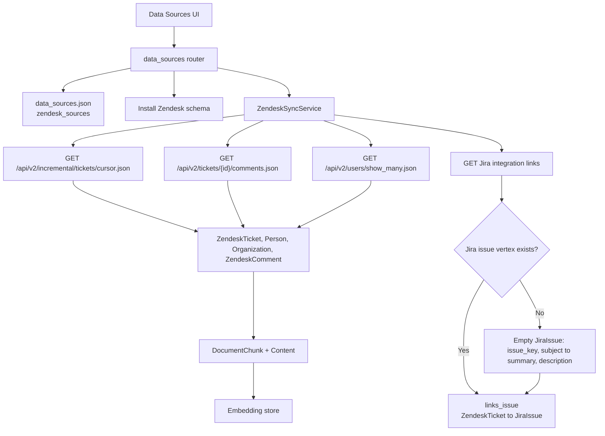

# Zendesk Data Source Connector

Status: target design for `GML-2348-zendesk-data-source-connector`, aligned with the Jira design on `GML-2211-feature-jira-source-connector`. The connector installed today does not match section 2 yet.

This document describes the Zendesk schema, which tickets are linked to Jira, the Zendesk APIs the sync calls, how ingestion writes the graph, which questions the agent answers, and which modules a second or customer-built connector reuses.

## Questions the agent answers

A type is added only when a row in this table needs it and the Zendesk API returns that data. `prompt_selection.py` tells the planner, the query step, and the answer step to use these types when the question is about Zendesk.

| Question | How it is answered | Vertex or edge |
|---|---|---|
| Tell me about ticket `59326`, or give me a summary. | Read `subject`, `description`, `status`, `priority`, and `ticket_type` from `ZendeskTicket`. Those are stored text. The embedding vector is not the text. | `ZendeskTicket` |
| What is the status of ticket `59326`? Is it open, pending, or solved? | `status` on `ZendeskTicket`. The values are New, Open, Pending, Solved, and Closed. | `ZendeskTicket` |
| How did the status change? From what, to what, when, and who changed it? | Each status change stores `ticket_id`, `from_value`, `to_value`, and `created`. `changed` is the person. The same records cover priority and assignee changes. | `ZendeskChange`, `changed` |
| What is the subject, description, priority, type, tags, custom fields, group, or URL? | Those are attributes on `ZendeskTicket`. Priority is Low, Normal, High, or Urgent. Type is Question, Incident, Problem, or Task. | `ZendeskTicket` |
| What files are attached? | The attachment stores the ticket id, file name, and content URL. The file bytes are not stored. | `Attachment` |
| Who requested it, and which customer are they in? | `requested` is the person who experiences the ticket. `member` is the organization that person belongs to. One person requests many tickets. | `requested`, `member` |
| What was commented, was it public or internal, and who wrote it? | The comment stores `ticket_id`, `body`, and `visibility`. `authored` is who wrote it. | `ZendeskComment`, `authored` |
| Which problem is this incident grouped under? | `problem_id` on the incident ticket. Both tickets are `ZendeskTicket`. That problem's `links_issue` edge points at one Jira bug or task. | `ZendeskTicket.problem_id`, `links_issue` |
| Which Jira issue does this ticket link to? | `links_issue`, from Zendesk's Jira link inventory. Many tickets can link to one issue. | `links_issue` |
| What is the Jira summary, description, priority, status, or labels for that link? | Follow the mapping on `links_issue`. Subject maps to summary. Description plus the public transcript maps to description. Priority and status are read on both sides. Tags map to labels and components. | `links_issue` |

A question that does not name a field, such as what went wrong for a customer, is searched in the stored description and comment bodies. It is not turned into a filter. If several tickets match, the agent lists ticket id, subject, and status and asks which one. If the user asks for a field Zendesk does not return, the answer says that field is not on the ticket.

A bare number, or "the ticket," can be Jira or Zendesk. The agent asks which one before it queries. Current status, priority, organization, group, and requester come from the vertices. Comment text does not replace those values. If the linked Jira issue has empty attributes and a Jira MCP server is configured, the agent fetches those details at query time with `issue_key`.

`configs/graph_configs/JiraTest/data_sources.json` has a Jira source and no Zendesk token, so the JSON below is the response shape the client reads, shortened to a few rows. It is not a live capture from a Zendesk account.

## 1. End-to-end flow



Operator sequence:

1. Save a Zendesk source: subdomain, email, API token, optional Jira integration external id, status filter, and `updated_after`.
2. Test the connection. The test calls `GET /api/v2/users/me.json` and tries the Jira link inventory.
3. Initialize the graph, then install the Zendesk schema.
4. Run sync. Tickets, requesters, and comments are written. Exact fields, including the description, are stored on the vertices. Chunks are copied from that stored text and then embedded.
5. After the ticket pages, Zendesk reads its Jira link inventory and writes `links_issue` for every valid row whose Zendesk ticket is in the graph. If that Jira issue is not in the graph yet, the same pass creates it with `issue_key`, and fills an empty `summary` from the ticket subject and an empty `description` from the ticket description plus the public comments.
6. If the run fails, the card shows the error and a Resume button. Resume calls the same sync. It continues from the last fully ingested ticket id and its `updated_at`, and it keeps `pending_comment_ticket_ids`. The page cursor is not the resume point.

## 2. Schema

`zendesk_schema_proposal()` installs the vertices and edges in the question table. Sync refuses to run until `zendesk_schema_status()` is `installed`. The graph must already have `Document`, `DocumentChunk`, `Content`, `CONTAINS_ENTITY`, `HAS_CHILD`, and `HAS_CONTENT`.

### Field mapping

`→` means the Zendesk field is the source. `←` means the Jira field is the source. `↔` means both values are kept.

| Zendesk field | Direction | Jira field | What the graph does |
|---|---|---|---|
| Ticket ID, for example `#10492` | `→` link | Custom field or web link | `links_issue` is that link. The issue is reached from the ticket id. A Jira custom field is not overwritten. |
| Issue key, for example `BUG-402` | `←` link | Custom field for the Jira issue | The same `links_issue` edge, read from the ticket to the issue key. |
| Subject | `→` | Summary | Initial context. If the Jira issue has no summary, the ticket subject is written as `summary`. An existing Jira summary is left as it is. |
| Description plus the public transcript | `→` | Description | Customer logs and reproduction steps. If the Jira issue has no description, the ticket description and public comments are written as `description`. An existing Jira description is left as it is. Internal notes are not part of this transfer. |
| Priority | `↔` | Priority | Both values stay on their own vertex. Low, Normal, High, and Urgent stay the Zendesk values. The connector does not write one side onto the other. |
| Status, for example Pending | `↔` | Status, for example In Progress | Both values stay. An answer can say Jira Done corresponds to Zendesk Solved. The connector does not change the other product's status. |
| Tags, for example `bug`, `tier1` | `→` | Labels or components | Tags stay on the ticket. Labels and components stay on the issue. Tags are the support filter. Labels and components are the engineering filter. Tags are not written over Jira labels. |

### Vertices

| Type | Why it exists | Attributes |
|---|---|---|
| `ZendeskTicket` | The support ticket. Question, incident, problem, and task are `ticket_type`. | `ticket_id`, `ticket_type`, `subject`, `description`, `status`, `priority`, `tags`, `custom_fields`, `problem_id`, `group_name`, `url`, `content_hash` |
| `Person` | The requester, assignee, reporter, or comment author. Shared. | `email`, `display_name` |
| `Organization` | The customer company or tier. Shared when the domain matches. | `name`, `domain` |
| `ZendeskComment` | The comment body. `visibility` is `public` or `internal`. | `comment_id`, `ticket_id`, `body`, `visibility`, `content_hash` |
| `ZendeskChange` | One status, priority, or assignee change. The current status stays on the ticket. | `change_id`, `ticket_id`, `field`, `from_value`, `to_value`, `created` |
| `Attachment` | A file on the ticket. Shared type. The bytes are not stored. | `file_name`, `content_url`, `parent_id` |

`description` and `body` are the stored text. A chunk is produced from that text so a vague question can search it. `Content.text` is a copy of the attribute. The vector written to the embedding store is not a copy of the text.

`custom_fields` is the name and value of each Zendesk custom field the ticket payload returns, joined as text. A custom field is not its own vertex.

`email` is written only when Zendesk returns it. The vertex id is then `person:{email}`, lowercased, which is the same vertex Jira writes when Jira returns `emailAddress`. A Zendesk user id and a Jira account id are different opaque ids, so neither is an attribute of `Person`. A matching display name is not the same vertex. If Zendesk omits the email, the id is `zendesk:{subdomain}:user:{user_id}` and that person is not merged.

A Zendesk ticket is never stored as a `JiraIssue`. `schema_reuse.must_remain_separate()` rejects that reuse even when a ticket id and an issue key look similar.

Vertex ids include the subdomain so two Zendesk accounts cannot collide:

- Ticket: `zendesk:{subdomain}:ticket:{ticket_id}`
- Person, when Zendesk returns `email`: `person:{email}`, lowercased. The same email from Jira or a later connector is this vertex.
- Person, when Zendesk omits the email: `zendesk:{subdomain}:user:{user_id}`
- Organization, when Zendesk returns a domain: `organization:{domain}`, lowercased. The same domain from a later connector is this vertex.
- Organization, when Zendesk omits the domain: `zendesk:{subdomain}:org:{organization_id}`
- Comment: `zendesk:{subdomain}:comment:{comment_id}`
- Change: `zendesk:{subdomain}:change:{audit_id}:{field}`
- Attachment: `zendesk:{subdomain}:attachment:{attachment_id}`

### Edges

| Edge | From | To | Why this edge exists |
|---|---|---|---|
| `requested` | `Person` | `ZendeskTicket` | "Who requested this ticket?" One person, many tickets. |
| `member` | `Organization` | `Person` | "Who is in this customer?" |
| `authored` | `ZendeskComment` | `Person` | "Who wrote this comment?" |
| `changed` | `ZendeskChange` | `Person` | "Who changed the status, priority, or assignee?" |
| `links_issue` | `ZendeskTicket` | `JiraIssue` | "Which Jira issue does this ticket link to?" Many tickets can link to one issue. Added when `JiraIssue` is already installed. The graph already uses `LINKS_TO` for communities. |

There is no edge from the comment to the ticket. The comment stores `ticket_id`. There is no edge from a change to the ticket. The change stores `ticket_id`. There is no edge from the ticket to the organization. The customer is the organization that has the requester as a `member`. There is no edge for the problem ticket. The incident stores `problem_id`. There is no edge that pairs a Zendesk comment with a Jira comment.

Search text uses the shared `DocumentChunk` and `Content` types. Each chunk connects to its `ZendeskTicket` through `CONTAINS_ENTITY`. A comment chunk also connects to its `ZendeskComment`.

If Jira is installed later, run the Zendesk schema install again so `links_issue` exists. `Person`, `Organization`, and `Attachment` are installed by whichever connector writes them first. The other connector reuses the installed type. There is no `ZendeskUser` type and no same-person edge.

`priority` is Zendesk's built-in priority (`low`, `normal`, `high`, `urgent`). `ticket_type` is `question`, `incident`, `problem`, or `task`. `tags` is the comma-separated tag list. `group_name` is the Zendesk group assigned to the ticket. The customer company is the `Organization` vertex.

## 3. Cross-linking

Zendesk reads its Jira integration link inventory and writes `links_issue` from the Zendesk ticket to the Jira issue. The Jira vertex id is `jira:{issue_key}:issue`, the same id the Jira connector uses.

The relation comes from Zendesk:

- `GET /api/v2/integrations/jira/{jira_integration_external_id}/links` when the source has an external id.
- `GET /api/v2/jira/links` when the external id is empty.

Each row must contain an `issue_key` shaped like `TSE-1073` and a numeric `ticket_id`. Any other row is skipped. A matching number in a summary, a label such as `jira_escalated`, or a URL in a comment is not a relation.

For `issue_key=TSE-1073` and `ticket_id=59326` on subdomain `tigergraph`:

- Zendesk vertex: `zendesk:tigergraph:ticket:59326`
- Jira vertex: `jira:tse-1073:issue`
- Edge: `links_issue` from the Zendesk vertex to the Jira vertex

| What is already in the graph | What Zendesk sync writes |
|---|---|
| The Zendesk ticket and the Jira issue | That one edge. Attributes already on the Jira issue are left unchanged. |
| The Zendesk ticket, and the Jira issue is not ingested yet | A `JiraIssue` with `issue_key`, `summary` taken from the ticket subject, and `description` taken from the ticket description plus the public comments, and that one edge. The next Jira sync fills the remaining attributes and does not wipe a summary or description Jira itself has written. |
| The Jira issue, and the Zendesk ticket was not returned by this sync | Nothing. Jira sync does not create the edge. |
| Neither vertex | Nothing. |

A ticket that is absent from the inventory stays unlinked. Removing a link removes the edge only. Zendesk does not delete the `JiraIssue`. Jira ingestion is not a second linking pass. It fills the attributes on the vertex Zendesk created.

The edge is present whether or not the Jira attributes are filled. Ingestion does not call Jira MCP. When an answer needs a summary, status, or description that is still empty on that `JiraIssue`, and a Jira MCP server is configured, the agent fetches those fields at query time using `issue_key`.

### Shared vertices

`Person` and `Organization` are the shared types. Jira writes `Person` for the assignee, the reporter, a comment author, and a change author. Zendesk writes `Person` for the requester and a comment author. Zendesk writes `Organization` from `organizations/show_many`. Jira does not write `Organization`. A later connector writes either type when it has the same email or the same company domain. If the API omits that id, the vertex stays scoped to that connector and is not merged. No connector creates its own user type or its own company type.

## 4. What is fetched from Zendesk

Auth is the agent email plus `/token`, and the API token, against `https://{subdomain}.zendesk.com`.

| Call | When |
|---|---|
| `GET /api/v2/users/me.json` | Connection test |
| `GET /api/v2/search/count.json` | Ticket-count preview. Query is `type:ticket` plus optional `updated>=` and `status:` filters |
| `GET /api/v2/incremental/tickets/cursor.json` | Ticket pages for the current run. The page cursor is not saved. The next run starts from the last fully ingested ticket. |
| `GET /api/v2/tickets/{id}.json` | One ticket whose comments failed on a previous run |
| `GET /api/v2/tickets/{id}/comments.json` | Comments for tickets on the current page, 5 tickets at a time, following `next_page` |
| `GET /api/v2/tickets/{id}/audits.json` | Status, priority, and assignee changes for those tickets |
| `GET /api/v2/users/show_many.json` | Requester and comment-author name and email, 100 ids at a time |
| `GET /api/v2/organizations/show_many.json` | Organization name and `domain_names` for each `organization_id` on the page |
| `GET /api/v2/groups/show_many.json` | Group name for each `group_id` on the page |
| `GET /api/v2/jira/links` or `GET /api/v2/integrations/jira/{id}/links` | After ticket pages. Cursor pages use `page[size]` and `page[after]` |

The incremental export is the ticket list. It does not include the comment thread or the Jira link inventory, so those stay separate calls.

### Raw samples

#### GET /api/v2/incremental/tickets/cursor.json

The sync reads `id`, `type`, `subject`, `description`, `status`, `priority`, `tags`, `custom_fields`, `organization_id`, `group_id`, `requester_id`, `problem_id`, `updated_at`, and `url`. `description` is stored on `ZendeskTicket`. `type` is `ticket_type`. `problem_id` stays on the incident ticket. `end_of_stream` ends the scan. `after_url` or `after_cursor` requests the next page inside this run only.

```json
{
  "tickets": [
    {
      "id": 10,
      "type": "incident",
      "subject": "Login fails",
      "description": "See https://acme.atlassian.net/browse/PAY-1",
      "status": "open",
      "priority": "high",
      "tags": ["bug"],
      "organization_id": 42,
      "group_id": 9,
      "requester_id": 7,
      "problem_id": 8,
      "updated_at": "2026-10-01T00:00:00Z",
      "url": "https://acme.zendesk.com/api/v2/tickets/10.json"
    }
  ],
  "end_time": 1700000000,
  "end_of_stream": false,
  "after_cursor": "cursor-token"
}
```

#### GET /api/v2/tickets/10/comments.json

The sync reads `id`, `body`, `author_id`, and `public`. `public` false is stored as `visibility` `internal`.

```json
{
  "comments": [
    {
      "id": 3,
      "author_id": 7,
      "public": false,
      "body": "Tried again"
    }
  ],
  "next_page": null
}
```

#### GET /api/v2/users/show_many.json?ids=7

The sync reads `id`, `name`, and `email`.

```json
{
  "users": [
    {"id": 7, "name": "Ada", "email": "ada@acme.com"}
  ]
}
```

#### GET /api/v2/jira/links

The reconciler reads `issue_key` and `ticket_id`. `issue_id` may be present and is not used as the graph id.

```json
{
  "links": [
    {
      "issue_id": "10001",
      "issue_key": "TSE-1073",
      "ticket_id": "59326"
    }
  ],
  "meta": {"has_more": false, "after": ""}
}
```

That one row is the relation between Jira `TSE-1073` and Zendesk ticket `59326`. A ticket that is not in `links` is not linked.

## 5. Ingestion and resume

Ingestion writes tickets. Resume writes the ids in `failed_ticket_ids`. A status change is a later ingest, when Zendesk returns that ticket again. `after_cursor` is only the handle for the next page inside the run that is already going. It is not written to `data_sources.json`.

### Ingestion

The first run starts at `updated_after` when that is set, otherwise at the start of the export. A later run starts at `sync.checkpoint`. Zendesk returns tickets changed at or after that time. The same run follows `after_cursor` until `end_of_stream`, so a ticket that is absent from the first page is written when its own page arrives.

Each page is handled in `updated_at` order, then ticket id. The ids on a page are the tickets that changed in that slice. Ticket `25` can sit between ticket `3` and ticket `8` because those are the tickets that changed then.

Before a ticket is written, ingestion looks up `zendesk:{subdomain}:ticket:{ticket_id}` and compares `content_hash` with the hash of the description and comment bodies just fetched. `content_hash` is set only after that ticket's attributes, comment bodies, and `Content.text` copies are written.

| Lookup | What ingestion does |
|---|---|
| No `ZendeskTicket` vertex | First insert. Write the ticket. |
| `content_hash` equals the new hash | Already in the graph. Leave the vertex and the embedding as they are. |
| `content_hash` differs | Someone updated the ticket in Zendesk, for example its status. Write the new status and the rest of the new text, then embed that text. |

The third row is a later ingest. It runs because Zendesk moved that ticket's `updated_at`, so the export returns it again. A failed write does not take this row.

A ticket is fully ingested only when all of these are written:

- the `ZendeskTicket` attributes, including `description`
- its `ZendeskComment.body` values
- the `Content.text` copied from those attributes

The embedding is built from `Content.text` after that write. A missing vector can be rebuilt from the stored text. A missing attribute cannot.

After each fully ingested ticket, two fields are saved on that source in `configs/graph_configs/<graph>/data_sources.json`:

- `sync.checkpoint`: that ticket's `updated_at`
- `sync.last_ticket_id`: that ticket id

`configs/` is mounted into the container, so this file is still there after the container is recreated. This pair is the latest ticket that finished. Inserted tickets are the vertices whose `content_hash` is set. When a ticket's write fails, its id is appended to `sync.failed_ticket_ids` and the file is saved. `checkpoint` stays on the last ticket that finished.

After tickets `2`, `3`, and `8` are written, the source looks like this:

```json
"zendesk_sources": [
  {
    "id": "zen",
    "sync": {
      "checkpoint": "2026-11-05T10:03:00Z",
      "last_ticket_id": 8,
      "failed_ticket_ids": [],
      "pending_comment_ticket_ids": [],
      "last_error": null,
      "last_link_error": null
    }
  }
]
```

`ZendeskSyncService.run()` during ingestion:

1. Refuse the run when the source is disabled or the schema is not installed.
2. Load the saved `checkpoint` and `last_ticket_id`.
3. Read ticket pages from the checkpoint. Keep a ticket when its status is in the saved list, if a list is set, and its `updated_at` is on or after `updated_after`.
4. For each kept ticket, do the lookup above. When the hash matches, leave that ticket. Otherwise load comments, audits, users, organizations, and groups, then upsert:
   - `ZendeskTicket` with `ticket_id`, `ticket_type`, `subject`, `description`, `status`, `priority`, `tags`, `custom_fields`, `problem_id`, `group_name`, `url`, and `content_hash`.
   - `Organization` with `name` and `domain`, and `member` to the requester when that user's payload has the same `organization_id`.
   - `Person` with `email` and `display_name` when Zendesk returned an email, and `requested` from that person to the ticket.
   - `ZendeskComment` with `ticket_id`, `body`, and `visibility`, and `authored` from the comment to its author.
   - `ZendeskChange` for each status, priority, and assignee change, with `ticket_id`, `field`, `from_value`, `to_value`, `created`, and `changed` to the person.
   - `Attachment` with `file_name`, `content_url`, and `parent_id` for each file on the ticket. The file bytes are not stored.
5. Copy `description` and each comment `body` into `Content.text`, then embed that copy. A comment request that fails records that ticket id in `pending_comment_ticket_ids`. The ticket vertex is still written. A ticket write that does not finish appends that id to `failed_ticket_ids` and saves the file. `checkpoint` stays where it was.
6. Save `checkpoint` and `last_ticket_id` after that ticket's text is stored. Remove that id from `failed_ticket_ids` when it is present.
7. After the pages, read the Jira link inventory. For each valid row whose Zendesk ticket is in the graph, upsert `links_issue` from `zendesk:{subdomain}:ticket:{ticket_id}` to `jira:{issue_key}:issue`. If that Jira vertex is missing, create it with `issue_key`, set `summary` from the ticket subject, and set `description` from the ticket description plus the public comment bodies. Do not invent status, priority, labels, or any other Jira attribute. If the vertex already exists, do not write it again. Replace that ticket's `links_issue` edges with the inventory rows for this run, so a removed Zendesk link does not stay in the graph. A link-inventory failure is stored on `last_link_error` and does not roll back the tickets already written.

### Resume

Resume retries the tickets whose ingest failed. A status change is the third row of the ingestion lookup, on a later run.

A failed run sets `last_error` and leaves the last successful pair in place. The Zendesk card then shows Resume next to that error. Resume calls this same sync. It does not clear `checkpoint`, `last_ticket_id`, `failed_ticket_ids`, or `pending_comment_ticket_ids` until each failed ticket has been written.

Tickets `2`, `3`, and `8` are inserted: each vertex has `content_hash` set. Ticket `25` failed: its id is in `failed_ticket_ids`.

```json
"sync": {
  "checkpoint": "2026-11-05T10:03:00Z",
  "last_ticket_id": 8,
  "failed_ticket_ids": [25],
  "pending_comment_ticket_ids": [],
  "last_error": "ticket 25 failed"
}
```

Resume then:

1. For each id in `failed_ticket_ids`, fetches that ticket with `GET /tickets/{id}.json` and writes it. Ticket `25` is written here. On success, that id is removed from the list. This step does not move `checkpoint`.
2. Retries `pending_comment_ticket_ids` the same way, by ticket id.
3. Continues the export from `checkpoint` for tickets this run never reached. A ticket already in the graph with the same `content_hash` is left as it is, so tickets `2`, `3`, and `8` are not written again.

| Failure | What remains | What Resume does |
|---|---|---|
| The ticket write fails | Tickets already written stay in the graph. The failed ids are in `failed_ticket_ids`. | Fetches each failed id and writes it. |
| Comments fail for some tickets | The ticket vertex stays. Those ids are in `pending_comment_ticket_ids`. | Retries those comments by ticket id. |
| The Jira link list fails | Tickets stay. `last_link_error` is set. | Reads the link list again after the tickets. |

Status, priority, type, tags, custom fields, and group stay on `ZendeskTicket`. The requester is `requested`. The customer is `member`. A question that asks for those fields, or for the description, reads the vertices. A summary question reads `subject` and `description`. Word search uses the copy of `description` and comment `body` in `Content.text`.

Sync does not create `Document` vertices. Embeddings are written by the connector through `aadd_embeddings`.

## 6. Shared connector module

Zendesk is the second connector. A customer connector should register the same way and should not import the Jira client, JQL, or Jira vertex names.

### Already shared

| Module | What a connector uses |
|---|---|
| `common/db/schema_utils.py` | `SchemaProposal` and `apply_proposal` |
| `connectors/source_file.py` | One `data_sources.json` per graph. Each connector replaces only its own key. Jira uses `sources`. Zendesk uses `zendesk_sources`. Source ids cannot collide. |
| `connectors/schema_reuse.py` | Reuse an installed vertex only when the normalized name matches and attribute types agree. `Person` and `Organization` are reused by every connector. `JiraIssue` and `ZendeskTicket` stay separate. |
| `connectors/prompt_selection.py` | One guidance entry per connector, selected by an identifier or the source name |
| Graph chunk types | `DocumentChunk`, `Content`, `CONTAINS_ENTITY`, `StructuredChunker`, `aadd_embeddings` |

### Move out of the Jira package before a customer connector

Zendesk already calls these Jira-private helpers. A third connector should import them from a shared module instead:

| Current location | Move to | What it is |
|---|---|---|
| `jira/mapper.py` | `connectors/records.py` | `VertexRecord` and `EdgeRecord` |
| `jira/sync.py` | `connectors/upsert.py` | `_upsert_payload` |
| `jira/schema.py` | `connectors/schema_status.py` | Attribute and edge-pair comparison used by `zendesk_schema_status` |

### What each connector still owns

- Connection and scope model.
- REST client.
- Schema proposal and vertex id prefix. People are written as `Person`. Customer companies are written as `Organization`. A connector does not add its own user type or company type.
- Mapper from that system's payload to `VertexRecord` and `EdgeRecord`, including which text is embedded.
- Sync policy: checkpoint field, retry set, and which edges are replaced.
- The identifier rule and three guidance strings in `prompt_selection.py`.
- One UI card and the router routes for test, schema, and sync.

### Registration

The router should call a connector through four objects, without importing another connector's client:

- `config_model`
- `schema_status(conn)` and `install_schema(conn)`
- `test_connection(source)`
- `sync(graphname, source, conn)`

A customer package then supplies those four objects plus a `prompt_selection` entry. It writes its own vertex names for its own objects. It writes people to `Person` and customer companies to `Organization`. A link to a Jira issue is an edge that package owns, written only from a relation its own API returned. The target uses the Jira connector's vertex id. When that vertex is missing, the package creates it with `issue_key` only.
