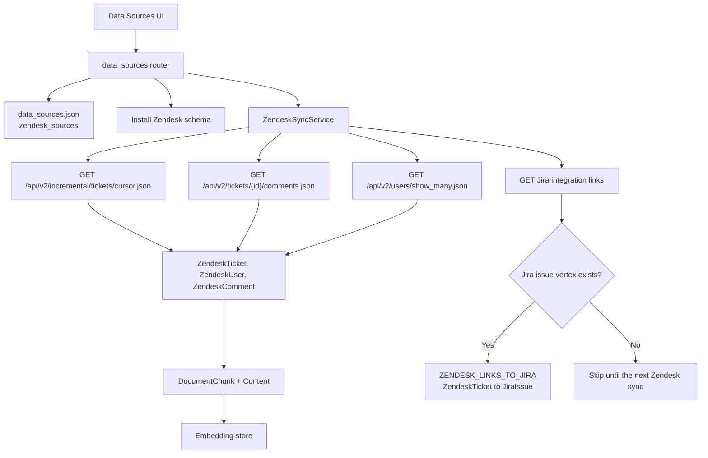

# Zendesk Data Source Connector

Status: target design for `GML-2348-zendesk-data-source-connector`.

This document describes the Zendesk schema, which tickets are linked to Jira, the Zendesk APIs the sync calls, how ingestion writes the graph, and which modules a second or customer-built connector reuses.

`configs/graph_configs/JiraTest/data_sources.json` has a Jira source and no Zendesk token, so the JSON below is the response shape the client reads, shortened to a few rows. It is not a live capture from a Zendesk account.

## 1. End-to-end flow



Operator sequence:

1. Save a Zendesk source: subdomain, email, API token, optional Jira integration external id, status filter, and `updated_after`.
2. Test the connection. The test calls `GET /api/v2/users/me.json` and tries the Jira link inventory.
3. Initialize the graph, then install the Zendesk schema.
4. Run sync. Tickets, requesters, and comments are written and embedded. After the ticket pages, Zendesk reads its Jira link inventory and writes `ZENDESK_LINKS_TO_JIRA` only for pairs whose Jira issue is already in the graph.

## 2. Schema

`zendesk_schema_proposal()` installs three vertex types and two ticket edges. Sync refuses to run until `zendesk_schema_status()` is `installed`. The graph must already have `Document`, `DocumentChunk`, `Content`, `CONTAINS_ENTITY`, `HAS_CHILD`, and `HAS_CONTENT`.

### Vertices

| Type | Role | Attributes |
|---|---|---|
| `ZendeskTicket` | One support ticket | `ticket_id`, `subject`, `status`, `url` |
| `ZendeskUser` | Requester or comment author | `user_id`, `display_name` |
| `ZendeskComment` | One comment body | `comment_id`, `body` |

A Zendesk ticket is never stored as a `JiraIssue`. `schema_reuse.must_remain_separate()` rejects that reuse even when a ticket id and an issue key look similar.

Vertex ids include the subdomain so two Zendesk accounts cannot collide:

- Ticket: `zendesk:{subdomain}:ticket:{ticket_id}`
- User: `zendesk:{subdomain}:user:{user_id}`
- Comment: `zendesk:{subdomain}:comment:{comment_id}`

### Edges

| Edge | From | To | Meaning |
|---|---|---|---|
| `ZENDESK_REQUESTED_BY` | `ZendeskTicket` | `ZendeskUser` | Requester |
| `ZENDESK_COMMENT_ON` | `ZendeskComment` | `ZendeskTicket` | Comment on that ticket |

Search text uses the shared `DocumentChunk` and `Content` types. Each chunk connects to its `ZendeskTicket` through `CONTAINS_ENTITY`. A comment chunk also connects to its `ZendeskComment`.

### Link edge

One edge is added by the Zendesk schema, and only when `JiraIssue` is already installed:

| Edge | From | To | Meaning |
|---|---|---|---|
| `ZENDESK_LINKS_TO_JIRA` | `ZendeskTicket` | `JiraIssue` | This ticket is the one named by a Zendesk Jira-integration link row |

Zendesk schema install adds this edge when `JiraIssue` is already installed. If Jira is installed later, run the Zendesk schema install again so the edge type exists.

## 3. Cross-linking

Zendesk reads its Jira integration link inventory and writes `ZENDESK_LINKS_TO_JIRA` from the Zendesk ticket to the existing Jira issue.

The relation comes from Zendesk:

- `GET /api/v2/integrations/jira/{jira_integration_external_id}/links` when the source has an external id.
- `GET /api/v2/jira/links` when the external id is empty.

Each row must contain an `issue_key` shaped like `TSE-1073` and a numeric `ticket_id`. Any other row is skipped. A matching number in a summary, a label such as `jira_escalated`, or a URL in a comment is not a relation.

For `issue_key=TSE-1073` and `ticket_id=59326` on subdomain `tigergraph`:

- Zendesk vertex: `zendesk:tigergraph:ticket:59326`
- Jira vertex: `jira:tse-1073:issue`
- Edge: `ZENDESK_LINKS_TO_JIRA` from the Zendesk vertex to the Jira vertex

| What is already in the graph | What Zendesk sync writes |
|---|---|
| The Zendesk ticket and the Jira issue | That one edge |
| The Zendesk ticket, and the Jira issue is not ingested yet | Nothing for this row. The next Zendesk sync reads the inventory again. |
| The Jira issue, and the Zendesk ticket was not returned by this sync | Nothing. Jira sync does not create the edge. |
| Neither vertex | Nothing |

A ticket that is absent from the inventory stays unlinked. Jira ingestion is not a second linking pass.

## 4. What is fetched from Zendesk

Auth is the agent email plus `/token`, and the API token, against `https://{subdomain}.zendesk.com`.

| Call | When |
|---|---|
| `GET /api/v2/users/me.json` | Connection test |
| `GET /api/v2/search/count.json` | Ticket-count preview. Query is `type:ticket` plus optional `updated>=` and `status:` filters |
| `GET /api/v2/incremental/tickets/cursor.json` | Ticket pages, from the checkpoint minus overlap, else `updated_after`, else `start_time=1` |
| `GET /api/v2/tickets/{id}.json` | One ticket whose comments failed on a previous run |
| `GET /api/v2/tickets/{id}/comments.json` | Comments for tickets on the current page, 5 tickets at a time, following `next_page` |
| `GET /api/v2/users/show_many.json` | Requester and comment-author names, 100 ids at a time |
| `GET /api/v2/jira/links` or `GET /api/v2/integrations/jira/{id}/links` | After ticket pages. Cursor pages use `page[size]` and `page[after]` |

The incremental export is the ticket list. It does not include the comment thread or the Jira link inventory, so those stay separate calls.

### Raw samples

#### GET /api/v2/incremental/tickets/cursor.json

The sync reads `id`, `subject`, `description`, `status`, `requester_id`, `updated_at`, and `url`. `end_time` becomes the checkpoint. `end_of_stream` ends the scan. `after_url` or `after_cursor` requests the next page.

```json
{
  "tickets": [
    {
      "id": 10,
      "subject": "Login fails",
      "description": "See https://acme.atlassian.net/browse/PAY-1",
      "status": "open",
      "requester_id": 7,
      "updated_at": "2026-10-01T00:00:00Z",
      "url": "https://acme.zendesk.com/api/v2/tickets/10.json"
    }
  ],
  "end_time": 1700000000,
  "end_of_stream": false,
  "after_cursor": "cursor-token"
}
```

#### GET /api/v2/tickets/10/comments.json

The sync reads `id`, `body`, and `author_id`.

```json
{
  "comments": [
    {
      "id": 3,
      "author_id": 7,
      "body": "Tried again"
    }
  ],
  "next_page": null
}
```

#### GET /api/v2/users/show_many.json?ids=7

The sync reads `id` and `name`.

```json
{
  "users": [
    {"id": 7, "name": "Ada"}
  ]
}
```

#### GET /api/v2/jira/links

The reconciler reads `issue_key` and `ticket_id`. `issue_id` may be present and is not used as the graph id.

```json
{
  "links": [
    {
      "issue_id": "10001",
      "issue_key": "TSE-1073",
      "ticket_id": "59326"
    }
  ],
  "meta": {"has_more": false, "after": ""}
}
```

That one row is the relation between Jira `TSE-1073` and Zendesk ticket `59326`. A ticket that is not in `links` is not linked.

## 5. Ingestion

`ZendeskSyncService.run()`:

1. Refuse the run when the source is disabled or the schema is not installed.
2. Retry tickets in `pending_comment_ticket_ids` through `GET /tickets/{id}.json`.
3. Read incremental ticket pages. Keep a ticket when its status is in the saved list, if a list is set, and its `updated_at` is on or after `updated_after`.
4. For each kept page, load comments and users, then upsert:
   - `ZendeskTicket` with `ticket_id`, `subject`, `status`, and `url`.
   - `ZendeskUser` and `ZENDESK_REQUESTED_BY` for `requester_id`.
   - `ZendeskComment` and `ZENDESK_COMMENT_ON` for each non-empty comment body.
5. Chunk and embed the ticket text and comment text. The ticket text is the ticket id, subject, description, and URL. The comment text is the ticket id, author name, and body.
6. Save the page `end_time` as the checkpoint. A comment request that fails records that ticket id and retries it on the next sync. The ticket vertex from the incremental page is still written.
7. After the pages, read the Jira link inventory. For each valid row, if both `zendesk:{subdomain}:ticket:{ticket_id}` and `jira:{issue_key}:issue` exist, upsert `ZENDESK_LINKS_TO_JIRA` from the ticket to the issue. Replace that ticket's link edges with the inventory rows for this run, so a removed Zendesk link does not stay in the graph. A link-inventory failure is stored on `last_link_error` and does not roll back the tickets already written.

Unstructured text is only the ticket narrative and the comment bodies. Current status and requester stay on `ZendeskTicket`, `ZendeskUser`, and `ZENDESK_REQUESTED_BY`. Word search matches subject, description, and comments. A question that asks for status or requester reads the vertices.

Sync does not create `Document` vertices. Embeddings are written by the connector through `aadd_embeddings`.

## 6. Shared connector module

Zendesk is the second connector. A customer connector should register the same way and should not import the Jira client, JQL, or Jira vertex names.

### Already shared

| Module | What a connector uses |
|---|---|
| `common/db/schema_utils.py` | `SchemaProposal` and `apply_proposal` |
| `connectors/source_file.py` | One `data_sources.json` per graph. Each connector replaces only its own key. Jira uses `sources`. Zendesk uses `zendesk_sources`. Source ids cannot collide. |
| `connectors/schema_reuse.py` | Reuse an installed vertex only when the normalized name matches and attribute types agree. `JiraIssue` and `ZendeskTicket` stay separate. |
| `connectors/prompt_selection.py` | One guidance entry per connector, selected by an identifier or the source name |
| Graph chunk types | `DocumentChunk`, `Content`, `CONTAINS_ENTITY`, `StructuredChunker`, `aadd_embeddings` |

### Move out of the Jira package before a customer connector

Zendesk already calls these Jira-private helpers. A third connector should import them from a shared module instead:

| Current location | Move to | What it is |
|---|---|---|
| `jira/mapper.py` | `connectors/records.py` | `VertexRecord` and `EdgeRecord` |
| `jira/sync.py` | `connectors/upsert.py` | `_upsert_payload` |
| `jira/schema.py` | `connectors/schema_status.py` | Attribute and edge-pair comparison used by `zendesk_schema_status` |

### What each connector still owns

- Connection and scope model.
- REST client.
- Schema proposal and vertex id prefix.
- Mapper from that system's payload to `VertexRecord` and `EdgeRecord`, including which text is embedded.
- Sync policy: checkpoint field, retry set, and which edges are replaced.
- The identifier rule and three guidance strings in `prompt_selection.py`.
- One UI card and the router routes for test, schema, and sync.

### Registration

The router should call a connector through four objects, without importing another connector's client:

- `config_model`
- `schema_status(conn)` and `install_schema(conn)`
- `test_connection(source)`
- `sync(graphname, source, conn)`

A customer package then supplies those four objects plus a `prompt_selection` entry. It writes its own vertex names. A link to a Jira issue is an edge that package owns, written only from a relation its own API returned, and only when that `JiraIssue` vertex is already in the graph.
